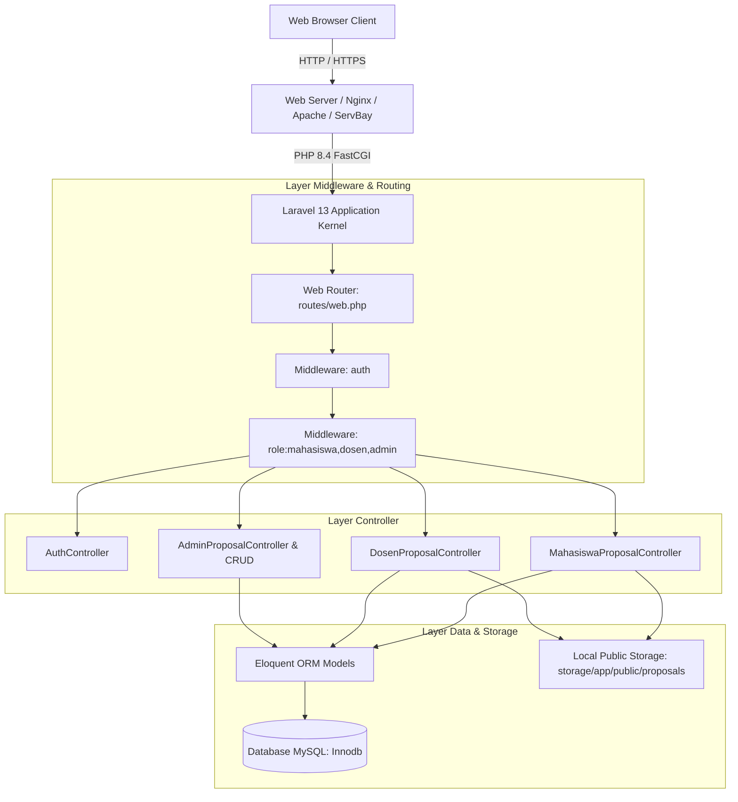
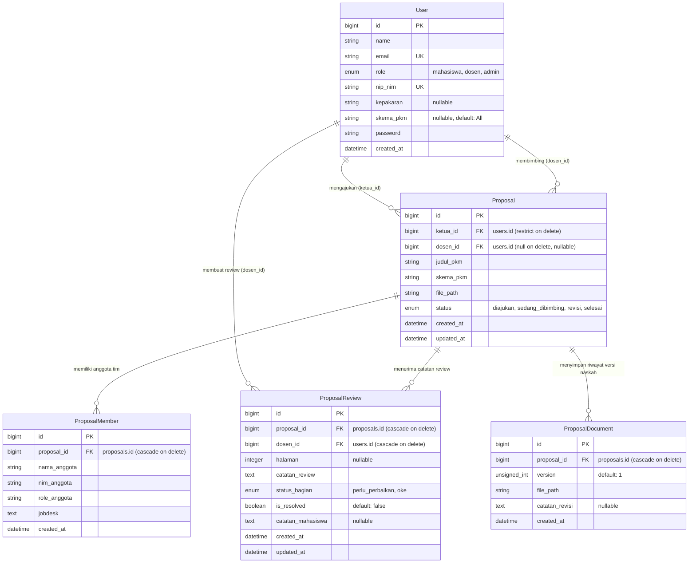

# SYSTEM MAP & LAPORAN AUDIT ARSITEKTUR
**Sistem Informasi Manajemen & Review Proposal PKM (SIM-PKM)**
*Repositori: `Proposal_UKM_Agent`*

---

## 1. Ringkasan Eksekutif (Executive Summary)

Aplikasi **SIM-PKM** adalah sistem berbasis web yang dibangun dengan framework **Laravel 13** dan **PHP 8.4** untuk memfasilitasi seluruh siklus hidup pengajuan, telaah (*review*), pembimbingan, dan pemantauan naskah **Program Kreativitas Mahasiswa (PKM)** di tingkat perguruan tinggi. 

Nama repositori menggunakan prefiks `Proposal_UKM_Agent`, namun secara domain logic sistem ini didesain spesifik untuk tata kelola proposal PKM (meliputi 8+ skema: PKM-RE, PKM-RSH, PKM-K, PKM-PM, PKM-PI, PKM-KC, PKM-KI, PKM-VGK, PKM-GFT, PKM-AI).

### Ringkasan Status Proyek
* **Framework Core**: Laravel Framework `13.32.0`
* **Runtime**: PHP `8.4.20`
* **Pengujian Otomatis**: **41 Tests Passed** (153 Assertions) tanpa kegagalan.
* **Frontend Stack**: Server-Side Blade Templating + Bootstrap 5.3 + Bootstrap Icons + Native Embedded PDF Viewer + Vanilla Fetch API (AJAX).
* **Database Driver**: MySQL (InnoDb) / SQLite (Testing Environment).
* **AI & Agent Integration**: Laravel Boost terkonfigurasi dengan guidelines dan MCP server aktif.

---

## 2. Peta Arsitektur Teknologi (Technology Stack)



---

## 3. Peta Model Data & Relasi Database (Data Architecture)

Sistem berpusat pada entitas `User` dan `Proposal`. Hubungan antar data diproteksi dengan foreign key constraints, cascading deletes pada relasi anak, dan row locking pada aksi kritis.

### 3.1 Diagram Hubungan Entitas (ERD)



### 3.2 Karakteristik Model & Indeks Database
1. **`User` (`app/Models/User.php`)**:
   - Kolom `role`: `'mahasiswa' | 'dosen' | 'admin'`
   - Kolom `skema_pkm`: Membatasi wewenang dosen terhadap skema tertentu (contoh: `'PKM-K'` hanya dapat melihat dan mengklaim usulan PKM Kewirausahaan; `'All'` untuk semua skema).
   - Helper methods: `isMahasiswa()`, `isDosen()`, `isAdmin()`, `canReviewSkema($skema)`.
2. **`Proposal` (`app/Models/Proposal.php`)**:
   - Memiliki composite index `['dosen_id', 'status']` untuk optimasi filter pencarian usulan bebas bagi dosen.
   - Relasi `latestDocument`: Menggunakan Eloquent `latestOfMany('version')` untuk mengambil versi PDF terkini.
3. **`ProposalDocument` (`app/Models/ProposalDocument.php`)**:
   - Composite index `['proposal_id', 'version']` untuk percepatan lookup versi naskah.
4. **`ProposalReview` (`app/Models/ProposalReview.php`)**:
   - Menyimpan interaksi dua arah: Catatan review dibuat dosen, dan status perbaikan (`is_resolved` serta `catatan_mahasiswa`) dikelola mahasiswa.

---

## 4. Peta Peran & Matriks Hak Akses (RBAC Matrix)

Otorisasi dikontrol melalui middleware `\App\Http\Middleware\RoleMiddleware` (alias `role` di `bootstrap/app.php`).

| Fitur / Halaman | Mahasiswa (Ketua Tim) | Dosen Pembimbing | Administrator Kampus | Tamu (Guest) |
|---|:---:|:---:|:---:|:---:|
| **Halaman Login & Quick Login** | ❌ (Redirect) | ❌ (Redirect) | ❌ (Redirect) | ✅ Akses Penuh |
| **Dashboard Usulan Mahasiswa** | ✅ Akses Penuh | ❌ 403 Forbidden | ❌ 403 Forbidden | ❌ Redirect Login |
| **Unggah Usulan Proposal Baru** | ✅ Akses Penuh | ❌ 403 Forbidden | ❌ 403 Forbidden | ❌ Redirect Login |
| **Unggah Berkas Naskah Revisi** | ✅ Akses Penuh | ❌ 403 Forbidden | ❌ 403 Forbidden | ❌ Redirect Login |
| **Checklist Perbaikan Review** | ✅ AJAX Toggle | ❌ 403 Forbidden | ❌ 403 Forbidden | ❌ Redirect Login |
| **Lihat Proposal Bebas (Claim Pool)** | ❌ 403 Forbidden | ✅ Terfilter Skema | ❌ 403 Forbidden | ❌ Redirect Login |
| **Klaim Usulan Bimbingan** | ❌ 403 Forbidden | ✅ Safe Lock | ❌ 403 Forbidden | ❌ Redirect Login |
| **Workspace Review (Split-Screen)** | ❌ 403 Forbidden | ✅ Proposal Bimbingan | ❌ 403 Forbidden | ❌ Redirect Login |
| **CRUD Catatan Review (AJAX)** | ❌ 403 Forbidden | ✅ Akses Penuh | ❌ 403 Forbidden | ❌ Redirect Login |
| **Ubah Status Proposal** | ❌ 403 Forbidden | ✅ Bimbingan/Revisi/Selesai | ❌ 403 Forbidden | ❌ Redirect Login |
| **Dashboard Monitoring PKM** | ❌ 403 Forbidden | ❌ 403 Forbidden | ✅ Akses Penuh | ❌ Redirect Login |
| **Kelola Data Mahasiswa (CRUD)** | ❌ 403 Forbidden | ❌ 403 Forbidden | ✅ Akses Penuh | ❌ Redirect Login |
| **Kelola Data Dosen (CRUD & Skema)**| ❌ 403 Forbidden | ❌ 403 Forbidden | ✅ Akses Penuh | ❌ Redirect Login |

---

## 5. Peta Rute & Controller (Routing & Controller Map)

Seluruh rute didefinisikan pada `routes/web.php`.

### 5.1 Rute Autentikasi & Publik
| Method | URI | Nama Rute | Controller & Method | Middleware |
|---|---|---|---|---|
| `GET` | `/` | - | Closure (Redirect ke `/login`) | - |
| `GET` | `/login` | `login` | `AuthController@showLoginForm` | `guest` |
| `POST` | `/login` | `login.post` | `AuthController@login` | `guest` |
| `GET` | `/quick-login/{role}` | `quick.login` | `AuthController@quickLogin` | `guest` |
| `POST` | `/logout` | `logout` | `AuthController@logout` | `auth` |

### 5.2 Rute Mahasiswa (`prefix: mahasiswa`)
| Method | URI | Nama Rute | Controller & Method | Middleware |
|---|---|---|---|---|
| `GET` | `/mahasiswa/dashboard` | `mahasiswa.dashboard` | `MahasiswaProposalController@dashboardMahasiswa` | `auth, role:mahasiswa` |
| `GET` | `/mahasiswa/proposal/create` | `mahasiswa.proposal.create` | `MahasiswaProposalController@createProposal` | `auth, role:mahasiswa` |
| `POST` | `/mahasiswa/proposal/store` | `mahasiswa.proposal.store` | `MahasiswaProposalController@storeProposal` | `auth, role:mahasiswa` |
| `POST` | `/mahasiswa/proposal/{proposal}/revision` | `mahasiswa.proposal.revision` | `MahasiswaProposalController@uploadRevision` | `auth, role:mahasiswa` |
| `PATCH` | `/mahasiswa/reviews/{review}/toggle-resolve` | `mahasiswa.reviews.toggle-resolve` | `MahasiswaProposalController@toggleResolveReview` | `auth, role:mahasiswa` |

### 5.3 Rute Dosen Pembimbing (`prefix: dosen`)
| Method | URI | Nama Rute | Controller & Method | Middleware |
|---|---|---|---|---|
| `GET` | `/dosen/proposals/available` | `dosen.proposals.available` | `DosenProposalController@listAvailableProposals` | `auth, role:dosen` |
| `POST` | `/dosen/proposals/{proposal}/claim` | `dosen.proposals.claim` | `DosenProposalController@claimProposal` | `auth, role:dosen` |
| `GET` | `/dosen/bimbingan` | `dosen.bimbingan.index` | `DosenProposalController@listBimbingan` | `auth, role:dosen` |
| `GET` | `/dosen/bimbingan/{proposal}` | `dosen.bimbingan.show` | `DosenProposalController@showWorkspace` | `auth, role:dosen` |
| `PATCH` | `/dosen/bimbingan/{proposal}/status` | `dosen.bimbingan.status.update` | `DosenProposalController@updateStatus` | `auth, role:dosen` |
| `POST` | `/dosen/bimbingan/{proposal}/review` | `dosen.bimbingan.review.store` | `DosenProposalController@storeReviewComment` | `auth, role:dosen` |
| `PUT` | `/dosen/reviews/{review}` | `dosen.reviews.update` | `DosenProposalController@updateReviewComment` | `auth, role:dosen` |
| `DELETE` | `/dosen/reviews/{review}` | `dosen.reviews.destroy` | `DosenProposalController@destroyReviewComment` | `auth, role:dosen` |

### 5.4 Rute Administrator Kampus (`prefix: admin`)
| Method | URI | Nama Rute | Controller & Method | Middleware |
|---|---|---|---|---|
| `GET` | `/admin/dashboard` | `admin.dashboard` | `AdminProposalController@dashboard` | `auth, role:admin` |
| `GET` | `/admin/proposals/{proposal}` | `admin.proposals.show` | `AdminProposalController@show` | `auth, role:admin` |
| `GET` | `/admin/mahasiswa` | `admin.mahasiswa.index` | `AdminMahasiswaController@index` | `auth, role:admin` |
| `GET` | `/admin/mahasiswa/create` | `admin.mahasiswa.create` | `AdminMahasiswaController@create` | `auth, role:admin` |
| `POST` | `/admin/mahasiswa` | `admin.mahasiswa.store` | `AdminMahasiswaController@store` | `auth, role:admin` |
| `GET` | `/admin/mahasiswa/{user}/edit` | `admin.mahasiswa.edit` | `AdminMahasiswaController@edit` | `auth, role:admin` |
| `PUT` | `/admin/mahasiswa/{user}` | `admin.mahasiswa.update` | `AdminMahasiswaController@update` | `auth, role:admin` |
| `DELETE` | `/admin/mahasiswa/{user}` | `admin.mahasiswa.destroy` | `AdminMahasiswaController@destroy` | `auth, role:admin` |
| `GET` | `/admin/dosen` | `admin.dosen.index` | `AdminDosenController@index` | `auth, role:admin` |
| `GET` | `/admin/dosen/create` | `admin.dosen.create` | `AdminDosenController@create` | `auth, role:admin` |
| `POST` | `/admin/dosen` | `admin.dosen.store` | `AdminDosenController@store` | `auth, role:admin` |
| `GET` | `/admin/dosen/{user}/edit` | `admin.dosen.edit` | `AdminDosenController@edit` | `auth, role:admin` |
| `PUT` | `/admin/dosen/{user}` | `admin.dosen.update` | `AdminDosenController@update` | `auth, role:admin` |
| `DELETE` | `/admin/dosen/{user}` | `admin.dosen.destroy` | `AdminDosenController@destroy` | `auth, role:admin` |
| `GET` | `/admin/administrators` | `admin.administrators.index` | `AdminAdministratorController@index` | `auth, role:admin` |
| `GET` | `/admin/administrators/create` | `admin.administrators.create` | `AdminAdministratorController@create` | `auth, role:admin` |
| `POST` | `/admin/administrators` | `admin.administrators.store` | `AdminAdministratorController@store` | `auth, role:admin` |
| `GET` | `/admin/administrators/{user}/edit` | `admin.administrators.edit` | `AdminAdministratorController@edit` | `auth, role:admin` |
| `PUT` | `/admin/administrators/{user}` | `admin.administrators.update` | `AdminAdministratorController@update` | `auth, role:admin` |
| `DELETE` | `/admin/administrators/{user}` | `admin.administrators.destroy` | `AdminAdministratorController@destroy` | `auth, role:admin` |

---

## 6. Alur Kerja Inti & Logika Bisnis (Core Workflows)

### 6.1 Alur Pengajuan Proposal Baru (Mahasiswa)
1. Mahasiswa mengisi formulir: Judul, Skema PKM, Berkas PDF naskah (maks. 10MB), dan daftar anggota tim (Nama, NIM, Role, Jobdesk).
2. `DB::transaction()` dijalankan:
   - PDF disimpan ke storage disk `public/proposals`.
   - Record `Proposal` dibuat dengan status `'diajukan'` dan `ketua_id = Auth::id()`.
   - Record anggota tim di-insert secara massal melalui `$proposal->members()->createMany(...)`.
   - Record `ProposalDocument` versi 1 (v1) dibuat sebagai naskah awal.
3. **Mekanisme Rollback Berkas Fisik**: Jika terjadi kegagalan database pada blok transaksi, blok `catch` secara eksplisit menghapus file PDF fisik dari storage disk untuk mencegah file yatim (*orphaned files*).

### 6.2 Alur Klaim Proposal (*Race-Condition Safe*) oleh Dosen
1. Dosen melihat daftar usulan berstatus `'diajukan'` yang `dosen_id IS NULL`. Usulan disaring otomatis berdasarkan bidang skema bimbingan dosen (`skema_pkm`).
2. Saat tombol *Claim* ditekan, `DB::transaction()` dijalankan dengan pemanggilan `lockForUpdate()`:
   ```php
   $proposal = Proposal::where('id', $proposalId)->lockForUpdate()->firstOrFail();
   ```
3. Sistem memeriksa ulang apakah `dosen_id` masih kosong. Jika dosen lain berhasil mengklaim pecahan milidetik sebelumnya, eksepsi `\DomainException` dilempar dan transaksi di-rollback secara aman tanpa konflik data.
4. Jika valid, `dosen_id` diisi ID dosen yang login dan status beralih menjadi `'sedang_dibimbing'`.

### 6.3 Alur Workspace Review Split-View & Version Switcher
1. Workspace review diakses dosen pada rute `/dosen/bimbingan/{proposal}`.
2. Tampilan dibagi menjadi dua kolom:
   - **Kolom Kiri (PDF Viewer)**: Menggunakan iframe terintegrasi dengan dropdown pemilih versi naskah (*version switcher*). Dosen dapat berganti naskah antar versi (v1, v2, v3) secara instan tanpa me-reload form review di sisi kanan.
   - **Kolom Kanan (Review Timeline & Form)**: Form pembuatan catatan review per nomor halaman dan pilihan status bagian (`perlu_perbaikan` atau `oke`).
3. Operasi penambahan, pengeditan, dan penghapusan catatan review dilakukan melalui **AJAX (Fetch API)**. Posisi baca PDF tidak pernah hilang atau ter-reset.
4. Header halaman menyediakan dropdown status proposal real-time (`sedang_dibimbing`, `revisi`, `selesai`).

### 6.4 Alur Revisi & Checklist Perbaikan (Mahasiswa)
1. Di dashboard mahasiswa, catatan review dosen ditampilkan dalam bentuk checklist evaluasi.
2. Mahasiswa dapat mencentang tombol checklist *"Tandai Sudah Diperbaiki"* via endpoint AJAX `toggleResolveReview`. Teks catatan otomatis dicoret dan status `is_resolved` tersimpan di database.
3. Setelah seluruh perbaikan siap, mahasiswa mengunggah berkas PDF revisi:
   - Sistem secara otomatis menghitung nomor versi berikutnya (`nextVersion = max(version) + 1`).
   - Berkas dicatat ke tabel `proposal_documents`.
   - `file_path` utama diperbarui dan status usulan dikembalikan secara otomatis ke `'sedang_dibimbing'` agar dosen mengetahui ada pembaruan naskah.

### 6.5 Alur Monitoring & Administrasi (Admin)
1. Dashboard admin menyajikan KPI metrik: Total proposal, usulan mencari pembimbing, sedang dibimbing, perlu revisi, dan usulan selesai.
2. Filter gabungan: Berdasarkan status, skema PKM, dan pencarian multi-kolom (judul usulan, nama/NIM mahasiswa, nama/NIP dosen).
3. Manajemen pengguna (Add Mahasiswa, Add Dosen) dengan proteksi integritas: User yang sudah terhubung dengan proposal aktif dilarang dihapus.

---

## 7. Temuan Audit Kode (Code Audit Findings)

### 7.1 Kelebihan & Praktik Positif (Strengths)
1. **Transaksional & Defensif**: Penggunaan `DB::transaction()` di seluruh operasi multi-tabel (`storeProposal`, `uploadRevision`, `claimProposal`) disertai penanganan rollback berkas PDF di disk fisik.
2. **Penanganan Konkurensi Unggul**: Penggunaan row-level pessimistic locking (`lockForUpdate()`) pada aksi klaim proposal sangat tepat untuk mencegah *double-claim race condition*.
3. **UX Workspace Review Terisolasi**: Implementasi AJAX penuh pada penambahan/pengeditan/penghapusan catatan review dan selektor versi PDF memecahkan kendala klasik iframe reload pada aplikasi web serupa.
4. **Cakupan Pengujian Sangat Kuat**: Memiliki 41 feature tests komprehensif (`ProposalPkmWorkflowTest`, `AdminDosenManagementTest`, `AdminMahasiswaManagementTest`) yang memverifikasi alur otorisasi, validasi data, pengunggahan berkas via `Storage::fake()`, hingga simulasi race condition.
5. **Skema Wewenang Berjenjang**: Pengaturan `skema_pkm` pada entitas dosen mencegah dosen mengklaim proposal di luar bidang keilmuan atau penugasan kampus.

### 7.2 Status Perbaikan Temuan Audit

#### 1. View Detail Usulan pada `AdminProposalController@show` (Status: ✅ RESOLVED / SELESAI)
* **Status**: **Telah Diperbaiki**
* **Implementasi**: 
  - Berkas tampilan [`resources/views/admin/proposal_detail.blade.php`](file:///c:/Applications/ServBay/www/Proposal_UKM_Agent/resources/views/admin/proposal_detail.blade.php) telah dibuat dengan desain Bootstrap 5 yang serasi dengan layout aplikasi.
  - Dilengkapi ringkasan ketua, dosen pembimbing, status usulan, tab susunan tim, tab riwayat versi naskah, dan tab catatan evaluasi review.
  - Diverifikasi dengan pengujian otomatis pada [`tests/Feature/AdminProposalShowTest.php`](file:///c:/Applications/ServBay/www/Proposal_UKM_Agent/tests/Feature/AdminProposalShowTest.php) (4 test cases passed).

#### 2. Kredensial Demo Quick-Login di Lingkungan Produksi (Status: ✅ RESOLVED / SELESAI)
* **Status**: **Telah Diproteksi**
* **Implementasi**: Menambahkan klausul `abort_if(app()->isProduction(), 404)` pada method `quickLogin` di [`app/Http/Controllers/AuthController.php`](file:///c:/Applications/ServBay/www/Proposal_UKM_Agent/app/Http/Controllers/AuthController.php).

#### 3. Keamanan Berkas Dokumen Usulan (Status: ✅ RESOLVED / SELESAI)
* **Status**: **Telah Diperbaiki & Diamankan**
* **Implementasi**: 
  - Seluruh pengunggahan dokumen proposal naskah awal dan naskah revisi dialihkan ke storage disk privat `'local'` (`storage/app/private/proposals`).
  - Dibuat controller terdedikasi [`app/Http/Controllers/ProposalDocumentController.php`](file:///c:/Applications/ServBay/www/Proposal_UKM_Agent/app/Http/Controllers/ProposalDocumentController.php) dengan rute terproteksi `route('proposals.file')` dan `route('proposals.documents.show')`.
  - Sistem memeriksa otorisasi secara ketat:
    - Mahasiswa hanya dapat membuka dokumen milik timnya sendiri (ketua tim atau anggota terdaftar).
    - Dosen pembimbing yang ditugaskan dapat membuka dokumen usulan bimbingannya.
    - Dosen lain hanya dapat melihat usulan yang masih berstatus terbuka (`dosen_id is null`) dan sesuai bidang skema bimbingannya (`canReviewSkema`).
    - Admin dapat memantau seluruh dokumen usulan.
    - Pengunjung tanpa hak akses ditolak dengan HTTP 403 Forbidden.
  - Seluruh tautan dokumen pada Blade views (`admin/dashboard`, `admin/proposal_detail`, `dosen/available_proposals`, `dosen/workspace_review`, `mahasiswa/dashboard`) telah dimigrasikan ke rute terproteksi.
  - Diverifikasi dengan pengujian otomatis pada [`tests/Feature/ProposalDocumentSecurityTest.php`](file:///c:/Applications/ServBay/www/Proposal_UKM_Agent/tests/Feature/ProposalDocumentSecurityTest.php) (10 test cases passed).

#### 4. Otorisasi Tersebar di Controller vs Laravel Policies (Priority: Low / Refactor)
* **Lokasi**: `MahasiswaProposalController` dan `DosenProposalController`.
* **Rekomendasi Lanjutan**: Dapat direfaktor ke Laravel Policies (`ProposalPolicy`) pada siklus refactoring berikutnya.

---

## 8. Rekomendasi Langkah Selanjutnya (Actionable Roadmap)

1. **Refactoring ke Laravel Policies (`ProposalPolicy`)**:
   Memusatkan seluruh aturan otorisasi usulan PKM ke dalam satu Policy class agar lebih deklaratif.
2. **Notifikasi Sistem (Email / In-App Notification)**:
   Mengirim notifikasi ketika mahasiswa mengunggah revisi baru atau saat dosen memberikan catatan review baru.
3. **Penyempurnaan Ekspor PDF / Lembar Pengesahan**:
   Menyediakan fitur generate lembar pengesahan otomatis berformat PDF jika usulan berstatus `selesai`.

